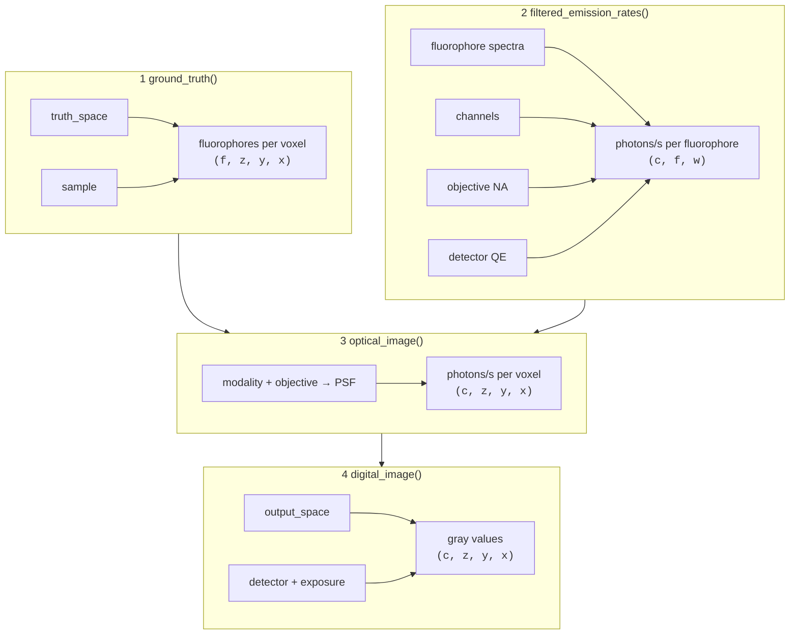

# Overview

A microsim simulation follows the light from the sample to the detector. This
page describes the parts of a simulation and the order in which they are used.
The following pages cover each part in detail.

## The `Simulation` object

All parameters live on one [`Simulation`][microsim.Simulation] object. Its
fields map onto parts of a real experiment:

| Field            | What it describes                                              | Guide                                   |
| ---------------- | -------------------------------------------------------------- | --------------------------------------- |
| `truth_space`    | the grid on which the sample and optics are computed            | [Spaces](spaces.md)                     |
| `output_space`   | the pixel grid of the final image                               | [Spaces](spaces.md)                     |
| `sample`         | where the fluorophores are, and which fluorophores they are     | [Samples](samples.md)                   |
| `channels`       | light sources and filters, one entry per channel                | [Channels](channels.md)                 |
| `objective_lens` | numerical aperture, refractive indices, coverslip              | [Modalities](modalities.md#objective-lens) |
| `modality`       | how the image is formed: widefield, confocal, ...               | [Modalities](modalities.md)             |
| `detector`       | camera or point detector, and its noise                        | [Detectors](detectors.md)               |
| `exposure_ms`    | camera exposure, or pixel dwell time for point scanners         | [Detectors](detectors.md#exposure-time) |
| `settings`       | compute backend, precision, random seed, caching               | [Settings](settings.md)                 |
| `output_path`    | where to save the result                                        | [Saving and loading](saving.md)         |

Only `truth_space` and `sample` are required.

## The stages

[`Simulation.run()`][microsim.schema.simulation.Simulation.run] computes four things in order.
Each is also available as a method, so you can stop at any stage, inspect the
intermediate result, or change a parameter and repeat only the later stages.



<span class="ms-stage">1</span> **Ground truth.** Each label in the sample is
drawn into the truth space. The result counts fluorophores per voxel, with one
layer per label (`f`). See [Samples](samples.md).

<span class="ms-stage">2</span> **Emission rates.** For every pair of
fluorophore and channel, microsim computes how many photons per second one
fluorophore emits and how many reach the detector, as a function of wavelength
(`w`). This includes the light source, excitation and emission filters, the
fluorophore's absorption and emission spectra, extinction coefficient and
quantum yield, the fraction of light the objective collects, and the
detector's quantum efficiency. It has no spatial dimensions. Because every
fluorophore is computed in every channel, bleedthrough and cross-excitation
follow automatically. See [Channels](channels.md) and
[Photon budget](photometry.md).

<span class="ms-stage">3</span> **Optical image.** The ground truth of each
fluorophore is multiplied by its emission rate and convolved with the
microscope's point spread function (PSF), then the fluorophores are summed
within each channel. The result is the noise-free light distribution at the
detector, in photons per second, still on the truth-space grid. See
[Modalities](modalities.md).

<span class="ms-stage">4</span> **Digital image.** The optical image is
binned to the output space, multiplied by the exposure time, and passed
through the detector model, which adds shot noise, dark current, gain, read
noise, and digitization. See [Detectors](detectors.md).


/// caption
Ground truth (left), optical image (center), and digital image (right) for
endoplasmic reticulum labeled with EGFP (green) and mitochondria labeled with
mCherry (magenta). The ground truth is from OpenOrganelle; see the
[two-color tutorial](../tutorials/two-color-cell.md).
///

There are two more methods for analysis.
[`optical_image_per_fluor()`][microsim.schema.simulation.Simulation.optical_image_per_fluor]
returns the optical image before fluorophores are summed, as
`(c, f, z, y, x)`, which shows how much of each channel comes from each
fluorophore. [`emission_flux()`][microsim.schema.simulation.Simulation.emission_flux] returns the
emitted photons per voxel before blurring.

## Units

microsim uses one unit per kind of quantity:

| Quantity                     | Unit                           |
| ---------------------------- | ------------------------------ |
| lengths (space scale, extent) | µm                            |
| wavelengths                  | nm                             |
| irradiance (`power`)         | W/cm²                          |
| exposure and dwell time      | ms                             |
| extinction coefficient       | M⁻¹ cm⁻¹                       |
| fluorescence lifetime        | ns                             |

## Outputs are labeled arrays

Every stage returns an [`xarray.DataArray`][xarray.DataArray]. Its dimensions
have names, and `z`, `y`, `x` carry coordinates in µm, so you can select and
reduce by name:

```py
digital = sim.run()
digital.sel(c="FITC")  # select a channel by name
digital.isel(z=8).plot()  # plot a plane (needs matplotlib)
sim.ground_truth().max("z")  # maximum projection
```

Use `digital.values` (or `numpy.asarray(digital)`) for a plain NumPy array.
With a GPU backend, `digital.data` is a GPU array; see
[Settings](settings.md#array-backends).

## What is (and isn't) modeled

microsim aims to make each modeled step physically correct, and to state the
approximations. The guide pages list the details for each part. In summary,
these are not modeled at present:

- photobleaching, blinking, and other time-dependent fluorophore behavior
  (emission is a steady-state rate)
- triplet and other dark states, and stimulated emission
- scattering, absorption, and aberrations from the sample (other than the
  refractive index mismatch handled by the PSF model)
- out-of-focus background other than what the PSF produces, and
  autofluorescence
- pixel-to-pixel variation of sCMOS cameras
- the camera's physical pixel size and magnification (the output pixel size
  is set by `output_space`)
