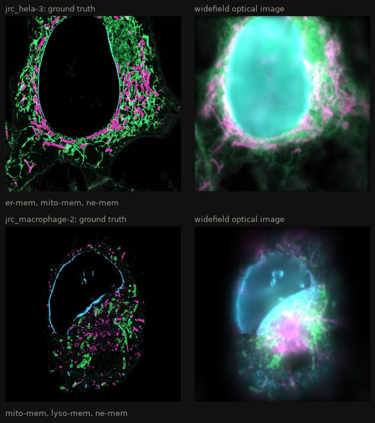

# Samples

The sample says where fluorophores are and which fluorophores they are. It is
a list of **labels**. Each label combines

- a **distribution**: how many fluorophores are in each voxel of the truth
  space, and
- a **fluorophore**: its spectra, brightness, and lifetime.

```py
sample = ms.Sample(
    labels=[
        ms.FluorophoreDistribution(
            distribution=ms.MatsLines(density=0.5),
            fluorophore="EGFP",
        ),
        ms.FluorophoreDistribution(
            distribution=ms.CosemLabel(dataset="jrc_hela-3", label="mito-mem_pred"),
            fluorophore="mCherry",
            concentration=10,
        ),
    ]
)
```

[`ground_truth()`][microsim.schema.simulation.Simulation.ground_truth] draws each label into the
truth space and stacks them along the `f` dimension. The values are
fluorophores per voxel.

!!! tip "Shorthand"

    `sample` also accepts a plain list, and a label can be a bare distribution.
    These are equivalent:

    ```py
    sample = ms.Sample(labels=[ms.FluorophoreDistribution(distribution=ms.MatsLines())])
    sample = [ms.MatsLines()]
    ```

    A label without a fluorophore gets a placeholder (see
    [below](#the-placeholder-fluorophore)).

## Distributions

### Random lines

[`MatsLines`][microsim.schema.MatsLines] draws randomly oriented,
one-voxel-wide line segments, with one fluorophore per voxel. It is quick to
compute and useful for testing.

| Parameter | Effect                                                                                       |
| --------- | -------------------------------------------------------------------------------------------- |
| `density` | number of lines, as a fraction of the X size in voxels (512 voxels × 0.5 = 256 lines)        |
| `length`  | line length: 1/20 of the field of view, plus a random amount up to `length`/20 of it        |
| `azimuth` | limits the tilt out of the XY plane: larger values give flatter lines                         |
| `max_r`   | lines are only drawn inside an ellipsoid of this relative radius (1 = touching the edges)     |


/// caption
Maximum projections of `MatsLines` ground truths in a 64 × 256 × 256 truth
space, with the defaults (`density=1`, `length=10`, `azimuth=10`,
`max_r=0.9`) and with one parameter changed at a time.
///

### OpenOrganelle (COSEM)

[`CosemLabel`][microsim.schema.CosemLabel] uses segmentations of organelles
from FIB-SEM volumes of cells, published by Janelia's COSEM project at
[OpenOrganelle](https://openorganelle.janelia.org/datasets). These give
realistic shapes for the endoplasmic reticulum, mitochondria, nuclear envelope,
microtubules, and more.

```py
ms.CosemLabel(dataset="jrc_hela-3", label="er-mem_pred")
```

- `dataset` is the dataset ID from the OpenOrganelle website (e.g.
  `jrc_hela-3`, `jrc_cos7-11`).
- `label` is the name of a segmentation or prediction layer in that dataset
  (e.g. `er-mem_pred`, `mito-mem_pred`, `ne_pred`), or its description.
- `position` (optional) selects the region to extract. By default the region
  is centered in the dataset.

The data are downloaded on first use and cached. This needs the `cosem` extra
and network access.


/// caption
Three labels each from two OpenOrganelle datasets (HeLa and macrophage cells),
on a 64 nm grid: one plane of the ground truth (left) and of the widefield
optical image (right), each label in its own color. In widefield, the top and
bottom of the nuclear envelope (cyan) blur into the plane, and fill the
nucleus.
///

!!! warning "Voxel size"

    The source data are stored at 4 nm voxels and at a series of 2×
    downsampled levels (8, 16, 32 nm, ...). microsim reads the level that
    matches the truth space without interpolating, so use the same scale on
    all three axes, equal to 4 nm times a power of two (e.g. `scale=0.064`).

### Allen Institute neurons

[`microsim.allen`][microsim.allen] fetches neuron reconstructions from the
[Allen Cell Types Database](https://celltypes.brain-map.org) and renders them as
a 3D mask, which can be used as a [fixed array](#your-own-array):

```py
from microsim.allen import NeuronReconstruction

mask = NeuronReconstruction.fetch(638976782).binary_mask(voxel_size=1)  # (Z, Y, X)
```


/// caption
Reconstruction 638976782 rendered at 1 µm voxels (maximum projections).
///

!!! warning "Not yet practical at optical resolution"

    `binary_mask` renders the whole neuron, hundreds of micrometers across, in
    one array, and the line widths it draws do not scale with `voxel_size`.
    At the 50 nm voxels that a simulation needs, the array would be far too
    large. For now, use it at about 1 µm to explore the morphology, or crop
    and resample the mask yourself.

### Your own array

If you already have a ground truth as an array, for example from a
segmentation, pass it directly with
[`Simulation.from_ground_truth`][microsim.schema.simulation.Simulation.from_ground_truth]:

```py
sim = ms.Simulation.from_ground_truth(
    my_array,  # (Z, Y, X), fluorophores per voxel
    scale=(0.04, 0.02, 0.02),  # voxel size in µm
    output_space={"downscale": 4},
    modality=ms.Confocal(),
)
```

This creates a truth space with the array's shape and a single label with the
placeholder fluorophore. To choose the fluorophore, or to combine several
arrays, build the labels yourself with a `"fixed-array"` distribution:

```py
sim = ms.Simulation(
    truth_space={"shape": nuclei.shape, "scale": (0.04, 0.02, 0.02)},
    sample=[
        {
            "distribution": {"type": "fixed-array", "array": nuclei},
            "fluorophore": "mTagBFP2",
        },
        {
            "distribution": {"type": "fixed-array", "array": actin},
            "fluorophore": "EGFP",
        },
    ],
)
```

Each array must have exactly the shape of the truth space.

The [own ground truth tutorial](../tutorials/your-own-ground-truth.md) has a
complete example.

### Your own generator

Any object with a `render(space, xp)` method can be used as a distribution.
`space` is an all-zero [`xarray.DataArray`][xarray.DataArray] with the shape and
coordinates of the truth space; return it with your fluorophore counts added:

```python
import numpy as np
from microsim import schema as ms


class PointSources:
    """Single-voxel emitters at random positions."""

    def __init__(self, n: int = 100, fluors_per_point: int = 500):
        self.n = n
        self.fluors_per_point = fluors_per_point

    def render(self, space, xp=None):
        idx = tuple(np.random.randint(0, s, self.n) for s in space.shape)
        data = np.zeros(space.shape, dtype=space.dtype)
        np.add.at(data, idx, self.fluors_per_point)
        return space + data


sample = [
    ms.FluorophoreDistribution(distribution=PointSources(), fluorophore="mCherry")
]
```

Each emitter here occupies a single voxel of the truth space, so it is a true
point source, much smaller than the PSF. Fluorescent beads are often 100 nm or
larger, not much smaller than the PSF; to simulate those, fill a sphere of
voxels for each bead instead (as with the shells in the
[own ground truth tutorial](../tutorials/your-own-ground-truth.md)).

With the NumPy backend, `np.random` is seeded from
[`Settings.random_seed`](settings.md#reproducibility) before rendering, so this
example is reproducible. Generators like this cannot be saved to JSON. To make
one that can, subclass
[`BaseDistribution`][microsim.schema.sample.BaseDistribution] (a pydantic
model).

!!! tip "Contributions welcome"

    Realistic ground truth makes for realistic simulations. If you write a
    generator others could use, please
    [open a pull request](https://github.com/tlambert03/microsim/pulls).

## Fluorophores

The simplest way to choose a fluorophore is by name. The spectra, extinction
coefficient, quantum yield, and lifetime are then loaded from
[FPbase](https://www.fpbase.org):

```py
ms.FluorophoreDistribution(distribution=..., fluorophore="mNeonGreen")
```

Any fluorescent protein or dye on FPbase with spectra can be used. The name
must match the name FPbase displays (case doesn't matter, but other spellings
don't work: `"Alexa Fluor 488"`, not `"AF488"`); the error message suggests the
closest match. This needs network access the first time.

To define a fluorophore yourself, give its spectra and photophysical
properties:

```py
ms.Fluorophore(
    name="MyDye",
    excitation_spectrum=ms.Spectrum(wavelength=wl_ex, intensity=ex),  # nm, any scale
    emission_spectrum=ms.Spectrum(wavelength=wl_em, intensity=em),
    extinction_coefficient=80_000,  # M⁻¹ cm⁻¹, at the excitation peak
    quantum_yield=0.6,
    lifetime_ns=3.5,
)
```

What each property does:

| Property                 | Used for                                                                                         |
| ------------------------ | ------------------------------------------------------------------------------------------------ |
| `excitation_spectrum`    | the shape of the absorption spectrum; it is normalized to 1 at its peak                          |
| `extinction_coefficient` | scales the absorption spectrum to an absorption cross section; required                          |
| `quantum_yield`          | the fraction of absorbed photons that are emitted (treated as 1 if not set)                       |
| `emission_spectrum`      | the distribution of emitted photons over wavelength; normalized to unit area                      |
| `lifetime_ns`            | [excitation saturation](photometry.md#excitation-saturation); no saturation if not set            |
| `bleaching_half_life_s`  | not used yet                                                                                     |

### The placeholder fluorophore

A label without a fluorophore uses `mockFluorophore`: flat excitation and
emission spectra from 300 to 799 nm, an extinction coefficient of
50,000 M⁻¹ cm⁻¹, a quantum yield of 1, and a 1 ns lifetime. It is excited by
any light source and passes any emission filter. Use it for testing; for
realistic brightness, color, and bleedthrough, use a real fluorophore.

## Concentration

`concentration` scales a label's distribution. A number multiplies it, so
`concentration=10` puts ten fluorophores wherever the distribution had one. A
function receives the rendered distribution and returns a new one, for example
to add labeling variability:

```py
def patchy(truth):
    rng = np.random.default_rng()
    return truth * rng.poisson(5, size=truth.shape)


ms.FluorophoreDistribution(distribution=..., fluorophore="EGFP", concentration=patchy)
```

What the values of a distribution mean depends on the distribution:

- `MatsLines` puts one fluorophore in each voxel of a line (more where lines
  cross).
- `CosemLabel` with a segmentation layer (names ending in `_seg`) gives the
  number of labeled 4 nm source voxels inside each truth voxel: up to 4096 in
  a 64 nm voxel. With a prediction layer (names ending in `_pred`), it gives
  the stored 8-bit prediction score (0–255) at the matching resolution level.
  Neither is a number of fluorophores.

So the brightness of a simulation depends strongly on the distribution and the
voxel size, and `concentration` is how you bring the labeling density in line
with your experiment. For scale: an EGFP molecule is a barrel about 4.2 nm long
and 2.4 nm wide
([Yang, Moss & Phillips 1996](https://doi.org/10.1038/nbt1096-1246)), about
19 nm³. Even a 10 nm voxel (1000 nm³) could hold only about 50 of them packed
solid, and a 64 nm voxel about 14,000. Real labeled structures are much
sparser than that: often hundreds to thousands of fluorophores per cubic
micrometer.

## Caching

Generating some ground truths is slow (`CosemLabel` downloads data), so
`MatsLines` and `CosemLabel` results are cached on disk, keyed by their
parameters, the truth space, the concentration, and (for random
distributions) the random seed. See [Settings](settings.md#caching) to clear
or disable the cache.
