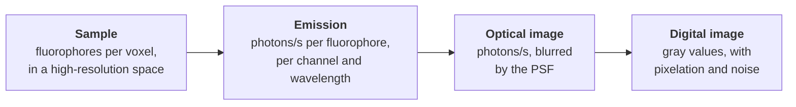

# microsim

<p class="lead">
microsim simulates fluorescence microscopy images. You describe a sample, a
microscope, and a detector, and it calculates the photons the sample emits, the
image the optics form, and the noisy digital image a camera or point detector
records.
</p>

<div class="ms-hero" markdown>
{ .off-glb }
<p class="caption">
Simulated images of nucleus, mitochondria, and endoplasmic reticulum.  The
ground truth comes from FIB-SEM segmentations of cell <code>jrc_hela-3</code>
at <a href="https://openorganelle.janelia.org/datasets/jrc_hela-3">OpenOrganelle</a>.
</p>
</div>

## What it's for

- **Ground truth for image analysis.** Every simulated image comes with the
  exact fluorophore distribution that produced it. You can use the pairs to
  train or benchmark segmentation, denoising, deconvolution, or
  super-resolution methods.
- **Planning experiments.** Ask what a different objective, filter set,
  fluorophore, exposure time, or detector would do to your images before you
  change them on the microscope.
- **Teaching.** Each step of image formation can be computed and plotted on its
  own: absorption spectra, filter transmission, PSFs, shot noise, read noise.

## How it works

A simulation is a single [`Simulation`][microsim.Simulation] object that holds
every parameter. Running it takes the sample through four stages:




Each stage has its own method, and returns a labeled
[`xarray.DataArray`][xarray.DataArray] that you can inspect, plot, or save. The
[User guide](guide/index.md) explains each stage.

## A first example

```python
from microsim import schema as ms
from microsim.util import ortho_plot

sim = ms.Simulation(
    truth_space=ms.ShapeScaleSpace(shape=(128, 512, 512), scale=(0.02, 0.01, 0.01)),
    output_space={"downscale": 8},
    sample=ms.Sample(labels=[ms.MatsLines(density=0.5, length=30, azimuth=5)]),
    detector=ms.CameraCMOS(),
)
result = sim.run()  # (C, Z, Y, X) array of gray values
ortho_plot(result)
```

[First simulation](getting-started/first-simulation.md) goes through this
example line by line.

## Where to go next

<div class="grid cards" markdown>

-   :lucide-download:{ .lg .middle } **Install**

    ---

    `pip install "microsim[all]"`, optional GPU backends, and a development
    setup.

    [:octicons-arrow-right-24: Installation](getting-started/installation.md)

-   :lucide-play:{ .lg .middle } **First simulation**

    ---

    Build a simulation step by step and look at the output of each stage.

    [:octicons-arrow-right-24: First simulation](getting-started/first-simulation.md)

-   :lucide-book-open:{ .lg .middle } **User guide**

    ---

    Samples, filters, light sources, PSFs, and detectors: what each part
    models and how to configure it.

    [:octicons-arrow-right-24: User guide](guide/index.md)

-   :lucide-braces:{ .lg .middle } **API reference**

    ---

    Every model, field, and default value.

    [:octicons-arrow-right-24: API reference](api/index.md)

</div>

!!! warning "Pin your version"

    microsim is in early development and changes quickly. New releases may
    include breaking API changes, and the same parameters may produce
    different simulation results as the physical models are corrected and
    extended. If you depend on microsim for a project, pin a specific version
    (e.g. `microsim==0.x.y`) and record it alongside your results.

Issues and pull requests are welcome on
[GitHub](https://github.com/tlambert03/microsim).
